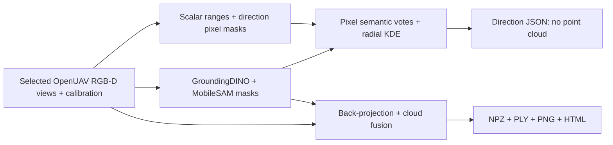

# GSA for AirSim: RGB-D Semantics, Direction Features and Point Clouds

Process OpenUAV / TravelUAV-style RGB-D observations using **GroundingDINO + MobileSAM**. Select any nonempty combination of `FrontCamera`, `LeftCamera`, `RightCamera`, `RearCamera`, and `DownCamera`.

The project provides two paths:

- **Direction features:** directly pool semantic pixels and calibrated radial depth inside 15 m action cones, without constructing XYZ points, voxels, or a full sphere. Default queries are **front, left 30°, right 30°, vertically down**, with a 20° full cone opening. Custom named yaw/elevation directions are supported.
- **3D clouds:** import or capture selected views, segment them, then back-project and fuse a drone-centered semantic/depth cloud. Save compressed **`cloud.npz`**, PLY files, a static PNG, and an interactive HTML viewer. Depth limits and voxel sampling are configurable.

The default direction wrapper reads front/down RGB-D and also returns **RAM image tags** for those two RGB images. For other camera selections, RAM is automatically skipped unless both front and down are selected. Use `--no-ram-tags` to run GSA alone. All pipeline code lives in this repository; no OJUAV checkout is required.



Grounded-MobileSAM takes RGB images and text category prompts. Depth is used separately for geometry. Unmatched observed pixels keep the `unknown` label. Acquisition also exports an RGB depth cloud before segmentation, without model inference.

## Model implementation

This project uses the [MobileSAM variant of GSA](https://github.com/IDEA-Research/Grounded-Segment-Anything/blob/126abe633ffe333e16e4a0a4e946bc1003caf757/EfficientSAM/grounded_mobile_sam.py), pinned to commit `126abe633ffe333e16e4a0a4e946bc1003caf757`.

## Requirements

The tested build uses Linux, an NVIDIA RTX4090, and:

| Component | Version |
| --- | --- |
| Python | 3.10.22 |
| CUDA Toolkit | 11.8 |
| PyTorch | 2.0.1+cu118 |
| torchvision | 0.15.2+cu118 |
| NumPy | 1.26.4 |
| transformers | 4.31.0 |
| timm | 0.6.13 |
| huggingface-hub / hf CLI | 0.34.4 |

Install Conda, Git, `curl`, a C++ compiler compatible with CUDA 11.8, and the **CUDA 11.8 Toolkit including `nvcc`** before compiling the operators. The optional download commands below include toolkit installation. Extracting TravelUAV archives also requires `7z` (for example, `p7zip-full` on Ubuntu). The PyTorch CUDA wheel alone does not provide the toolkit required to compile GroundingDINO's custom operators.

For live capture, prepare a running OpenUAV / AirSim environment separately. For offline use, prepare a compatible TravelUAV trajectory. Simulation binaries and datasets are not included in this repository.

## Installation

### 1. Clone and create the environment

```bash
git clone https://github.com/hfcvhsn/GSA_for_AirSim_3DSemanticDepthPointCloud.git
cd GSA_for_AirSim_3DSemanticDepthPointCloud

conda env create -f env/environment.yml
conda activate rgbd-sem3d
```

### 2. Download resources and build dependencies

Run from the repository root. The commands in this step use explicit paths; record those paths in the configuration in step 3. Skip cloning source directories and downloading weights that are already present at the specified versions.

Get the pinned source code:

```bash
mkdir -p third_party assets/checkpoints .cache/pip .cache/huggingface

git clone https://github.com/IDEA-Research/Grounded-Segment-Anything.git third_party/Grounded-Segment-Anything
git -C third_party/Grounded-Segment-Anything checkout --detach 126abe633ffe333e16e4a0a4e946bc1003caf757
```

Install Python dependencies. NumPy, OpenCV, and the fixed RPC client must be installed before AirSim:

```bash
export PIP_CACHE_DIR="$PWD/.cache/pip"
pip install setuptools==69.5.1 wheel==0.43.0 ninja==1.11.1.3
pip install torch==2.0.1+cu118 torchvision==0.15.2+cu118 --index-url https://download.pytorch.org/whl/cu118
pip install numpy==1.26.4 msgpack==1.1.0 tornado==4.5.3 opencv-python==4.10.0.84
pip install --no-build-isolation 'msgpack-rpc-python @ git+https://github.com/tbelhalfaoui/msgpack-rpc-python.git@938a57e9c26604e7e03d9971afeda810f4e43cd2'
pip install --no-build-isolation -r requirements.txt -c env/constraints.txt
```

Install the fixed RPC fork with the explicit pip command before installing `requirements.txt`: AirSim imports `msgpackrpc` while generating its installation metadata. The RPC dependency is omitted from `requirements.txt` to avoid repeating that source installation. `msgpack==1.1.0` remains pinned there as the separate serialization library used by RPC.

RPC compatibility is handled by the project's [`OpenUAVClient`](src/openuav/client.py): it subclasses `airsim.MultirotorClient` and omits the obsolete `pack_encoding` / `unpack_encoding` constructor arguments. The capture script uses this adapter, so **no edits to the installed AirSim package are required**.

For a fresh installation, download MobileSAM, GroundingDINO, and the BERT files to the following locations, then enter those locations in the configuration in step 3. Skip each download if that resource is already available.

```bash
export HF_HOME="$PWD/.cache/huggingface"
export HF_HUB_OFFLINE=0

curl -fL --retry 3 -o assets/checkpoints/mobile_sam.pt \
  https://raw.githubusercontent.com/ChaoningZhang/MobileSAM/f706ad9c4eb7f219c00d9050e46328518ffb65d2/weights/mobile_sam.pt
curl -fL --retry 3 -o assets/checkpoints/groundingdino_swint_ogc.pth \
  https://github.com/IDEA-Research/GroundingDINO/releases/download/v0.1.0-alpha/groundingdino_swint_ogc.pth
hf download google-bert/bert-base-uncased \
  config.json pytorch_model.bin tokenizer.json tokenizer_config.json vocab.txt \
  --revision 86b5e0934494bd15c9632b12f734a8a67f723594 \
  --local-dir assets/bert-base-uncased
```

RAM is optional for GSA-only use; the default front/down wrapper output also requires RAM. Get its pinned source and checkpoint and install its small additional dependency (skip existing resources):

```bash
git clone https://github.com/xinyu1205/recognize-anything.git third_party/recognize-anything
git -C third_party/recognize-anything checkout --detach 7cb804a8609e9f4b1a50b7f31436d2df40bb9481
pip install -r env/requirements-ram.txt -c env/constraints.txt
hf download xinyu1205/Recognize_Anything-Tag2Text ram_swin_large_14m.pth \
  --repo-type space --revision 7c76cec1377de0d46df8091a032c4b667aea4459 \
  --local-dir assets/checkpoints
```

RAM uses the existing local BERT tokenizer; no separate BERT download is needed. Keep the project’s dependency versions rather than installing RAM’s training requirements. Its paths are under the `ram` config section; see [RAM setup](docs/RAM_TAGS.md).

The pinned `huggingface-hub[cli]==0.34.4` dependency provides the [`hf` CLI](https://huggingface.co/docs/huggingface_hub/v0.34.4/en/guides/cli). Model files stay under `assets/`; source checkouts stay under `third_party/`.

`curl -o` saves the response from the given URL to the named file. `hf download` retrieves the listed BERT files from the specified repository revision into `--local-dir`. These commands create regular files; they do not create symbolic links. Existing models can instead be reused through configured paths or `ln -s`, as shown in the local guide. Skip downloads through existing model links: `curl -o` follows a symlink and writes to its source file.

#### Optional: Download CUDA 11.8 and TravelUAV resources

Run only the blocks for resources you need. Keep archives under `data/downloads/`. The standard locations below match `resources.example.json`, which you can select directly in step 3; use `resource.local.json` for custom locations. These commands download files when you execute them; the toolkit and dataset are not bundled with this project.

**CUDA 11.8 Toolkit (Linux x86_64).** Use the [NVIDIA CUDA 11.8 archive](https://developer.nvidia.com/cuda-11-8-0-download-archive) and [runfile installation options](https://docs.nvidia.com/cuda/archive/11.8.0/cuda-installation-guide-linux/index.html#runfile-installation):

```bash
mkdir -p data/downloads/cuda assets/cuda-11.8
curl -fL --retry 3 -o data/downloads/cuda/cuda_11.8.0_520.61.05_linux.run \
  https://developer.download.nvidia.com/compute/cuda/11.8.0/local_installers/cuda_11.8.0_520.61.05_linux.run
sh data/downloads/cuda/cuda_11.8.0_520.61.05_linux.run \
  --silent --toolkit --toolkitpath="$PWD/assets/cuda-11.8"
assets/cuda-11.8/bin/nvcc --version
```

This installs the toolkit into the project and uses the machine's existing NVIDIA driver. The example configuration already sets `paths.cuda_home` to `assets/cuda-11.8`; if you use CUDA 11.8 installed elsewhere, enter that existing directory in your local configuration instead.

**TravelUAV trajectory data.** The [official dataset](https://huggingface.co/datasets/wangxiangyu0814/TravelUAV/tree/faa8f2514156455ea7423464cc1295e6f92575cb) is distributed as one split-ZIP group per map. Download one map first; this example matches the offline pipeline example below:

```bash
mkdir -p data/downloads/TravelUAV data/TravelUAV
MAP=Carla_Town01
hf download wangxiangyu0814/TravelUAV --repo-type dataset \
  --revision faa8f2514156455ea7423464cc1295e6f92575cb \
  --include "${MAP}.z*" --local-dir data/downloads/TravelUAV
7z x "data/downloads/TravelUAV/${MAP}.zip" -odata/TravelUAV
```

`${MAP}.z*` includes `.zip` and every `.z01`, `.z02`, etc. Keep all parts together and start extraction from the `.zip` file. Change `MAP` for another map. For the full dataset, omit `--include` and extract each map's `.zip`. Set `paths.dataset_root` to the extracted directory directly containing map folders, such as `Carla_Town01/<trajectory>/frontcamera/` and its depth/log folders; adjust for any extra enclosing archive directory.

**TravelUAV simulation environments.** The [official environment repository](https://huggingface.co/datasets/wangxiangyu0814/TravelUAV_env/tree/44de5739a95a2f6a88767446421cddada9606642) provides separate archives. The following downloads the NYC/NewYorkCity group and the Carla town group:

```bash
mkdir -p data/downloads/TravelUAV_env data/traveluav_env
hf download wangxiangyu0814/TravelUAV_env --repo-type dataset \
  --revision 44de5739a95a2f6a88767446421cddada9606642 \
  --include "closeloop_envs.z*" "carla_town_envs.z*" \
  --local-dir data/downloads/TravelUAV_env
7z x data/downloads/TravelUAV_env/closeloop_envs.zip -odata/traveluav_env
7z x data/downloads/TravelUAV_env/carla_town_envs.zip -odata/traveluav_env
```

Keep each group's complete split archive together. Set `paths.simulator_root` to the extracted parent directory of `closeloop_envs` and `carla_town_envs`, adjusting for any extra enclosing archive directory. Other maps have separate archives listed in the same repository. The simulation binaries must be launched before live capture; offline data import only needs the trajectory data. Reserve space for both downloaded archives and extracted files.

#### Build the CUDA operators

Build GroundingDINO's CUDA operators and install the shared SAM components:

```bash
export CUDA_HOME="$PWD/assets/cuda-11.8"  # Use your existing toolkit if applicable; record this path in step 3.
export PATH="$CUDA_HOME/bin:$PATH"
export LD_LIBRARY_PATH="$CUDA_HOME/lib64:${LD_LIBRARY_PATH:-}"
export TORCH_CUDA_ARCH_LIST=8.9       # RTX4090; adjust for your GPU.
export MAX_JOBS=2
pip install --no-deps --no-build-isolation -e ./third_party/Grounded-Segment-Anything/segment_anything
AM_I_DOCKER=true BUILD_WITH_CUDA=true pip install --no-deps --no-build-isolation \
  -e ./third_party/Grounded-Segment-Anything/GroundingDINO
```

Dependency versions and source/model references are recorded in `requirements.txt`, `env/constraints.txt`, and `config/sources.json`. Source checkouts, weights, caches, and outputs are excluded from Git.

### 3. Configure resource paths

**If you followed step 2, including the Optional downloads, and kept the example locations, directly select [config/resources.example.json](config/resources.example.json):**

```bash
export SEM3D_CONFIG="$PWD/config/resources.example.json"
```

This includes CUDA at `assets/cuda-11.8`, trajectory data at `data/TravelUAV`, and environments at `data/traveluav_env`. Confirm that the extracted map and environment folders are directly under those roots. With this layout, you can proceed to step 4 without filling the local file.

**For existing resources or custom locations**, create `config/resource.local.json` directly, then fill in its empty values. This file is ignored by Git; the blank reference is [resource.local.example.json](config/resource.local.example.json). No copy command is needed.

```bash
cat > config/resource.local.json <<'JSON'
{
  "paths": {
    "gsa_source": "",
    "dino_checkpoint": "",
    "sam_checkpoint": "",
    "bert": "",
    "cuda_home": "",
    "dataset_root": "",
    "simulator_root": ""
  }
}
JSON
```

Use the locations created by the download commands in step 2, or enter the paths of resources you already have:

| Key under `paths` | What to enter | Location used in the examples |
| --- | --- | --- |
| `gsa_source` | Pinned GSA source directory | `third_party/Grounded-Segment-Anything` |
| `dino_checkpoint` | GroundingDINO checkpoint file | `assets/checkpoints/groundingdino_swint_ogc.pth` |
| `sam_checkpoint` | MobileSAM checkpoint file | `assets/checkpoints/mobile_sam.pt` |
| `bert` | Directory containing BERT weights, config, and tokenizer files | `assets/bert-base-uncased` |
| `cuda_home` | CUDA 11.8 Toolkit directory containing `bin/nvcc` | `assets/cuda-11.8` |
| `dataset_root` | Extracted data root containing map directories | `data/TravelUAV` |
| `simulator_root` | Extracted simulation root containing `closeloop_envs` / `carla_town_envs` | `data/traveluav_env` |

Enter directory paths for directory fields and full filenames for checkpoint fields. Paths can refer to existing resources or the planned locations used by the download commands. Replace every empty string before running the pipeline; an unfilled path produces an error naming the missing field.

Then select the configuration from the repository root:

```bash
export SEM3D_CONFIG="$PWD/config/resource.local.json"
```

`resource.local.json` only needs resource paths. Other pipeline settings are inherited from `config/resources.example.json`; you may add `capture`, `dataset`, `segmentation`, `cloud`, or `ram` sections to override individual settings. The default RPC endpoint is `127.0.0.1:41451` and the vehicle name is `Drone_1`, which can also be overridden on the capture command line.

Relative paths inside the configuration resolve from the repository root. CLI input/output paths resolve from the current working directory. `SEM3D_CONFIG` selects the pipeline configuration; individual Python commands also accept `--config`. Without either override, they read `config/resources.json`, which contains portable paths matching `resources.example.json`. `paths.simulator_root` records the simulation location; the pipeline connects to an already running AirSim server.

### 4. Verify the installation

```bash
# Choose a GPU available to you; it becomes cuda:0 inside this process.
export CUDA_VISIBLE_DEVICES=0

python -m pip check
python scripts/check_env.py --cuda --models
```

The environment check strictly loads MobileSAM and executes a GroundingDINO CUDA operator with a numerical result check. GroundingDINO and BERT are loaded together when running the segmentation stage.

In a new shell, activate the environment, select your config, and load the runtime paths again:

```bash
conda activate rgbd-sem3d
cd /path/to/GSA_for_AirSim_3DSemanticDepthPointCloud
export SEM3D_CONFIG="$PWD/config/resources.example.json"  # Use config/resource.local.json for custom paths.
source env/activate.sh
export CUDA_VISIBLE_DEVICES=0
```

## Run the pipeline

Run commands from the repository root. Each output directory must be empty or absent; choose a new run name when repeating an experiment.

### One command: front/down RGB-D to four actions and RAM tags

After installation and resource configuration:

```bash
source env/activate.sh
export CUDA_VISIBLE_DEVICES=0

python scripts/run_pipeline.py \
  --input Carla_Town01/00c9b2a9-eaa8-4b18-86ad-9f402e5cbb51 \
  --frame 000005
```

For this default command, only `frontcamera`, `frontcamera_depth`, `downcamera`, and `downcamera_depth` are required. Each contains `<frame>.png`. With standard 90° FOV and a near-level vehicle, the front view supports the three horizontal queries and the down view supports vertical down. Actual coverage still depends on camera offsets, occlusion and valid depth; each cone may be only partly observed. Extra views can be selected with `--cameras` for tilted vehicles or different calibration. Logs are optional; without an attitude log, geometry assumes a level vehicle. Metric NPY captures with `meta.json` are also supported. [Input layouts and calibration](docs/RGBD_TO_ACTIONS.md).

Stdout is a JSON object with `actions` and `ram_tags`. The four action rows are ordered **`front, L30, R30, DOWN`**. `ram_tags.front` and `ram_tags.down` contain English `tags` and Chinese `tags_zh` lists. Each row contains `action`, `depth_m`, `semantic_id`, and `semantic_name`. A cone without a return uses `null`, `-1`, `no_return`; unknown observations keep ID 0. Defaults are a **15 m radius**, **20° full cone opening** (10° half-angle), and 0.4 m radial KDE bandwidth. Each valid sampled pixel casts one semantic vote, including unknown; there are no voting subgrids.

The default run is quiet and stays in memory, with no intermediate files. Reuse the Python object or `--stream` worker to avoid reloading models. Add `--output outputs/actions_run_0001` to save diagnostic captures, masks, `action_features.npz`, and `action_values.json/csv`; the directory must be empty or absent. This path also skips point clouds. The standalone three-stage tools below remain available when a full cloud is explicitly needed. Use `--verbose` for model logs and tracebacks.

### Any camera combination and custom directions

Read only the selected view folders. Unselected views are neither opened nor inferred:

```bash
python scripts/run_pipeline.py \
  --input /path/to/sample --frame 000005 \
  --cameras FrontCamera

python scripts/run_pipeline.py \
  --input /path/to/sample --frame 000005 \
  --cameras FrontCamera LeftCamera RightCamera RearCamera DownCamera \
  --no-ram-tags --directions config/directions.example.json
```

Edit [directions.example.json](config/directions.example.json) to choose names and angles, or supply your own JSON list. Yaw is positive to the right (`-180..180°`); elevation is positive upward (`-90..90°`). Output order follows the list. Directions can also be set under `actions.directions` in the resource config; `--directions` takes precedence. The shared `--window-deg` controls full cone opening.

A single view is valid input even when it cannot see every requested direction: unobserved directions return `null/-1/no_return`, rather than invented depth or labels. Explicit `--ram-tags` requires both front and down views. The [Python API and geometry](docs/RGBD_TO_ACTIONS.md) describe the same options.

### Front/down RAM image tags

The unified wrapper enables [official RAM image tags](docs/RAM_TAGS.md) automatically when both front and down views are selected. Its source, checkpoint and dependency are required for this output. RAM can also run independently on the two RGB images:

```bash
python scripts/tag_rgb_views.py \
  --front-rgb /path/to/sample/frontcamera/000005.png \
  --down-rgb /path/to/sample/downcamera/000005.png

# The unified wrapper returns four action rows and both views’ RAM tags by default.
python scripts/run_pipeline.py --input /path/to/sample
```

RAM tagging needs no depth when called independently. It does not change GSA segmentation categories. Use `--no-ram-tags` to skip RAM and output only the four action rows.

The original three stage scripts below remain available for capture, inspection, and individual-stage use.

### Presentation images

[Render two sample demonstration figures](docs/DEMO_IMAGES.md): front/down RGB and semantic masks, plus an unwrapped depth/semantic view with the four measured action labels. This is an explicit presentation script; the normal wrapper stays free of point clouds and full-sphere rendering.

### Standalone stage 1: Acquire selected RGB-D views

Choose live capture or offline import. Both produce the same input layout for the next two stages. The default is all five views; add `--cameras FrontCamera DownCamera` or any other nonempty subset to either command.

#### Live OpenUAV / AirSim capture

Configure these cameras on the vehicle:

| Camera | Body offset (X, Y, Z), meters | Roll, pitch, yaw, degrees |
| --- | --- | --- |
| FrontCamera | (1, 0, 0) | (0, 0, 0) |
| LeftCamera | (0, -1, 0) | (0, 0, -90) |
| RightCamera | (0, 1, 0) | (0, 0, 90) |
| RearCamera | (-1, 0, 0) | (0, 0, 180) |
| DownCamera | (0, 0, 0) | (0, -90, 0) |

[config/airsim_settings.example.json](config/airsim_settings.example.json) provides a five-camera settings template. Use it when preparing your own AirSim scene, or merge its camera definitions into your existing settings before launching. If your OpenUAV launcher generates settings, configure the launcher to use equivalent values. Scene and DepthPerspective must share resolution, FOV, and pixel alignment; the example uses 256×256 and 90° horizontal FOV.

Start the simulation using its own launch procedure, then capture:

```bash
RUN=outputs/live_0001

python scripts/capture_openuav.py \
  --ip 127.0.0.1 --port 41451 --vehicle-name Drone_1 \
  --pause --output "$RUN/capture"
```

`--pause` synchronizes vehicle and image poses during capture and restores the previous pause state afterward. Live fusion requires synchronized capture unless you explicitly accept separately sampled poses with `--allow-unsynchronized` in step 3.

The script saves float32 metric depth, RGB images, intrinsics, image-response camera poses, timestamps, and the vehicle pose. Default raw BGR images are converted to RGB. For a customized server, `--raw-color-order RGB` and `--flip-vertical` provide explicit overrides; flipping transforms RGB, depth, and intrinsics together.

#### Offline TravelUAV import

Point `paths.dataset_root` to an existing dataset and specify a trajectory and frame:

```bash
RUN=outputs/offline_0001

python scripts/capture_openuav.py \
  --from-dataset --allow-quantized-depth \
  --trajectory Carla_Town01/00c9b2a9-eaa8-4b18-86ad-9f402e5cbb51 \
  --frame 000005 --output "$RUN/capture"
```

The trajectory must contain the selected RGB folders (`frontcamera`, `leftcamera`, `rightcamera`, `rearcamera`, `downcamera`) and corresponding `_depth` folders. Images use `<frame>.png`. Optional `log/<frame>.json` supplies `sensors.state.position` and an orientation quaternion (`sensors.state.orientation`) in xyzw order. Without a log, geometry uses a level vehicle at a virtual body origin and records `world_pose_known=false`.

This importer supports TravelUAV's uint8 depth encoding `clip(depth_m, 0, 100) / 100 * 255`. The reconstructed depth is approximate, with a quantization step of about 0.392 m; values 0 and 255 are discarded. Camera poses are derived from the vehicle reference and [the standard camera layout](config/openuav_cameras.json). Supply `--camera-layout` and adjust `dataset.fov_deg` if your dataset uses different calibration. The dataset itself must be obtained separately.

All 828 local trajectories in `BrushifyCountryRoads` and `NordicHarbour` contain depth files, but their PNGs and tensors have abnormal depth values. Use `scripts/recapture_depth.py` to replay recorded poses in a running AirSim scene and acquire fresh five-view RGB with float depth. The [depth audit and recapture guide](docs/DEPTH_AUDIT_AND_RECAPTURE.md) includes the full audit results, manual scene launch commands, and examples for both scenes.

Both live capture and offline import automatically create `$RUN/capture/depth_cloud/` with `rgb.ply`, `cloud.npz`, `meta.json`, `cloud.html`, and `cloud.png`. Recapture creates the same directory inside each `<frame>/`. These clouds use RGB colors and require no semantic masks. Sampling, depth limits, and voxel size use the `cloud` configuration; `--no-render` skips only HTML/PNG. Constant or invalid depth is flagged in metadata and preview titles; no valid points produces an empty diagnostic cloud. Unsynchronized live poses are also marked; use `--pause` for synchronized capture.

### Standalone stage 2: Generate semantic masks with Grounded-MobileSAM

Keep the `RUN` variable from step 1:

```bash
python scripts/segment_gsa.py \
  --input "$RUN/capture" \
  --output "$RUN/masks" \
  --device cuda:0
```

Configure category names and thresholds under `segmentation` in your config. To override the categories for a run:

```bash
python scripts/segment_gsa.py \
  --input "$RUN/capture" --output "$RUN/masks_custom" \
  --classes 'building,road,sidewalk,tree,grass,car,person' \
  --device cuda:0
```

Each view receives a uint16 semantic map, an instance map, detection confidence, segment metadata, and colored previews. Category IDs are shared across all views; `0` means unknown. Overlapping masks are assigned to the highest-scoring GroundingDINO detection. MobileSAM selects the candidate mask with the highest predicted IoU for each box. No detections produce valid all-zero maps.

### Standalone stage 3: Fuse and render the point cloud

```bash
python scripts/fuse_cloud.py \
  --input "$RUN/capture" \
  --masks "$RUN/masks" \
  --output "$RUN/cloud" --max-depth 15
```

If you used `masks_custom`, pass that directory to `--masks`. The fusion stage checks that the masks refer to the same capture metadata. `--max-depth 15` keeps camera depths below 15 m; the existing cloud geometry and filtering are retained. Cloud depth limits are camera-relative, while the direct direction wrapper separately applies a 15 m UAV-centered radius.

To convert an existing capture without semantic masks, omit `--masks`:

```bash
python scripts/fuse_cloud.py \
  --input "$RUN/capture" \
  --output "$RUN/depth_cloud_only"
```

Open `$RUN/cloud/cloud.html` in a browser to rotate, zoom, and toggle categories. The viewer embeds Plotly and requires no Python display server. `$RUN/cloud/cloud.png` provides a static preview.

Common options:

| Option | Effect |
| --- | --- |
| `--min-depth 0.5 --max-depth 80` | Keep depths in `[0.5, 80)` meters |
| `--stride 1` | Sample every depth pixel; default is every second pixel |
| `--voxel-size 0` | Disable voxel thinning; default voxel size is 0.15 m |
| `--labeled-only` | Export only points with a known category |
| `--no-render` | Export point-cloud files without HTML/PNG previews |

## Outputs and coordinates

```text
outputs/<run>/
├── capture/
│   ├── meta.json
│   ├── depth_cloud/
│   │   ├── rgb.ply / cloud.npz
│   │   ├── cloud.html / cloud.png
│   │   └── meta.json
│   └── <Camera>/
│       ├── rgb.png
│       ├── depth_perspective_m.npy
│       └── camera.json
├── masks/
│   ├── meta.json
│   └── <Camera>/
│       ├── semantic.npy / instances.npy / confidence.npy
│       ├── segments.json
│       └── semantic.png / overlay.png
└── cloud/
    ├── cloud.npz
    ├── semantic.ply / rgb.ply
    ├── cloud.html / cloud.png
    └── meta.json
```

Point coordinates are expressed in the **current drone body FRD frame**, in meters: **X forward, Y right, Z down**. The drone center is the origin. A depth-only `cloud.npz` stores `xyz`, `rgb`, and `view_id`; its `rgb.ply` contains XYZ, RGB, and view IDs. Semantic clouds additionally store `semantic_id`, `instance_id`, and `confidence`, and export `semantic.ply`. Instance IDs are local to a view; use `(view_id, instance_id)` as the key.

[AirSim DepthPerspective](https://microsoft.github.io/AirSim/image_apis/#depthplanar-and-depthperspective) measures distance along the pixel ray. Back-projection normalizes each ray before multiplying by depth, then applies the exposure camera pose and inverse vehicle pose:

```text
ray_camera_FRD = normalize([1, (u - cx) / fx, (v - cy) / fy])
point_camera  = depth_range * ray_camera_FRD
point_world   = R_world_camera * point_camera + t_world_camera
point_body    = R_world_body.T * (point_world - t_world_body)
```

Nonfinite, nonpositive, and out-of-range depths are filtered. Voxel thinning retains a real highest-confidence point per semantic class and voxel for semantic clouds, or the first sampled point per voxel for depth-only clouds. HTML/PNG previews sample at most `cloud.render_max_points`; PLY/NPZ retain all exported points.

## Validation and limitations

Run the tests with:

```bash
python -m pip install -r env/requirements-dev.txt
python -m pytest tests -q
```

The [release validation record](docs/VALIDATION.md) documents 118 passing tests and real NewYorkCity GSA/RAM inference and cloud rendering. Tests cover capture/RPC compatibility, all 31 nonempty camera combinations using selected-view-only fixtures, prepared capture round trips, custom directions, scalar geometry against an independent XYZ reference, missing and unknown returns, and NPZ/PLY/PNG/HTML cloud output. Model inference is replaced by deterministic fixtures in unit tests; actual model inference additionally requires the downloaded resources and a compatible GPU.

The dataset copies previously inspected for `BrushifyCountryRoads` and `NordicHarbour` had abnormal depth; the [audit and recapture guide](docs/DEPTH_AUDIT_AND_RECAPTURE.md) records the limits. Files can be exported from constant depth, but this does not recover valid scene geometry.

Semantic labels depend on prompts and model predictions and may be incorrect. Offline PNG depth is quantized, and its camera calibration is assumed from the supplied layout. The pipeline processes one observation; it does not perform temporal mapping, cross-view instance association, or surface reconstruction. The pinhole projection assumes registered RGB/depth with matching FOV and no additional distortion.

## Repository layout

| Directory | Contents |
| --- | --- |
| `scripts/` | Unified RGB-D-to-actions CLI, individual stages, environment check, depth audit and recapture helpers |
| `src/` | Reusable pipeline, independent action query core, capture, model adapter, geometry, export, rendering |
| `config/` | Resource configuration, source versions, and camera examples |
| `env/` | Environment setup and dependency constraints |
| `tests/` | Regression tests |

Models, datasets, simulator binaries, local resource overrides, caches, and run outputs are excluded from version control. Source commits and model download references are recorded in [config/sources.json](config/sources.json).

## Acknowledgments

This project builds on [Grounded-Segment-Anything](https://github.com/IDEA-Research/Grounded-Segment-Anything), [GroundingDINO](https://github.com/IDEA-Research/GroundingDINO), [MobileSAM](https://github.com/ChaoningZhang/MobileSAM), [Segment Anything](https://github.com/facebookresearch/segment-anything), and [AirSim](https://github.com/microsoft/AirSim). Consult the upstream repositories for their licenses, model terms, and citation instructions.
